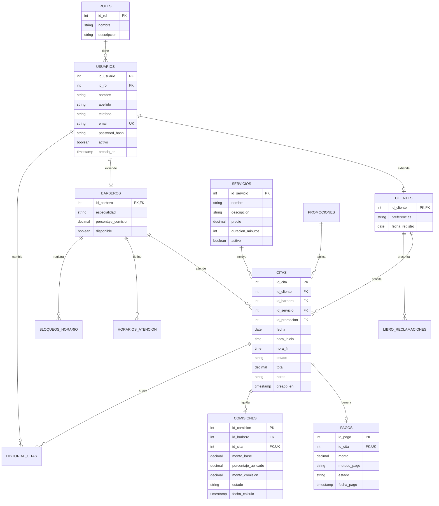

# 💈 A&S Barber Shop — Sistema Web Integral de Gestión Comercial & Reservas Online

<p align="center">
  
</p>

<p align="center">
  <strong>Plataforma Web Empresarial para Barbería Tradicional & Cuidado Personal Masculino</strong><br>
  <em>Sede Miraflores · Galería Pardo, Sótano Tienda 18 · Fundada en 1991 · Lima, Perú</em>
</p>

<p align="center">
  
  
  
  
  
  
  
  
</p>

---

## 📌 Resumen Ejecutivo del Proyecto

**A&S Barber Shop** es una solución web integral diseñada para digitalizar, optimizar y automatizar la operativa completa de una barbería clásica de alta gama. Desarrollada para la histórica sede ubicada en la emblemática **Av. José Pardo 620 en Miraflores**, la plataforma integra una experiencia comercial de cara al cliente (*Landing Page* de alta fidelidad estética y sistema de agendamiento online en tiempo real) con un robusto motor administrativo para el control de inventario de servicios, agenda de maestros barberos, liquidación de comisiones, trazabilidad de cobros multimétodo y cumplimiento legal normado por INDECOPI.

---

## 🌟 Características Principales del Sistema

### 1. Portal Comercial & Landing Page Editorial (Dark Luxury)
* **Identidad Visual Premium:** Paleta cromática profunda (`#0a0908`), tipografía de impacto *Archivo Black* inspirada en barberías icónicas internacionales y acentos en Cyan Eléctrico (`#06b6d4`).
* **Experiencia de Navegación 60 FPS:** Barra reactiva de lectura que mide el progreso del scroll en tiempo real, observador de intersección (`IntersectionObserver`) para animaciones de entrada fluidas y *ScrollSpy* sincronizado con la barra de navegación.
* **Geolocalización & Sede Miraflores:** Integración de Google Maps con filtro interactivo en *Dark Mode* y visualización alternable de la fachada real del local comercial.
* **Contacto Inmediato:** Botón flotante oficial de WhatsApp (+51 986 717 861) con mensaje preconfigurado y distintivos de métodos de pago peruanos (Yape, Plin, Visa, Mastercard, American Express y Efectivo).

### 2. Diseño Responsivo Mobile-First de Alto Rendimiento
* **Cabecera Adaptativa:** Limpieza visual automática en pantallas móviles (`< 640px`), priorizando la identidad de marca y evitando botones saturados.
* **Menú Hamburguesa en Drawer Overlay:** Menú desplegable flotante con efecto *Glassmorphism* (`backdrop-blur-2xl`) y bloqueo de scroll de fondo, manteniendo intacto el flujo del documento.
* **Blindaje Anti-desborde:** Prevención estricta de desplazamiento horizontal indeseado (`overflow-x: hidden` a nivel de raíz) para una sensación táctil nativa.
* **Ergonomía Táctil:** Botones de acción principales y enlaces optimizados para el alcance natural del pulgar en smartphones.

### 3. Wizard de Reservas de Citas en 4 Pasos (Portal Cliente)
* **Paso 1: Selección de Servicio:** Tarifas claras, tiempos estimados y descripción del tratamiento.
* **Paso 2: Selección de Barbero:** Opción de elegir a un maestro barbero específico o asignación inteligente.
* **Paso 3: Consulta de Disponibilidad en Tiempo Real:** Cálculo dinámico de bloques horarios libres sin solapamientos.
* **Paso 4: Validación y Promociones:** Aplicación de cupones de descuento vigentes y confirmación instantánea con número de reserva.
* **Panel de Autogestión:** Cancelación con motivo registrado y reprogramación de citas en línea.

### 4. Panel Operativo del Maestro Barbero
* **Agenda Diaria y Semanal:** Visualización organizada de clientes agendados y turnos del día.
* **Cambio de Estados Operativos en Vivo:** Transición fluida entre `PENDIENTE`, `CONFIRMADA`, `EN_PROCESO`, `ATENDIDA` y `CANCELADA`.
* **Módulo de Cobro Rápido:** Registro del pago al culminar la atención con desglose por medio de pago (Yape, Plin, Tarjeta, Efectivo).
* **Liquidación Automática de Comisiones:** Cálculo en tiempo real de comisiones por servicio (`monto_base × porcentaje / 100`).

### 5. Panel de Control Administrativo (Master Dashboard)
* **Métricas Clave:** Ingresos del día, citas activas, servicios más demandados y barberos con mayor rendimiento.
* **Gestión Integral de Usuarios:** Altas, bajas lógicas, reseteo de claves y asignación de roles (`ADMIN`, `BARBERO`, `CLIENTE`).
* **Gestión de Servicios & Precios:** Catálogo parametrizable con tiempos de ejecución e impacto en disponibilidad.
* **Módulo de Promociones:** Creación de campañas de descuento con fechas de vigencia y límites de uso.
* **Auditoría Financiera:** Historial detallado de transacciones e historial de cambios de estado en citas (`historial_citas`).

### 6. Libro de Reclamaciones Virtual (Normativa INDECOPI)
* Formulario virtual adaptado a la legislación de protección al consumidor del Perú (Ley N° 29571).
* Generación de código correlativo único y oficial (ejemplo: `REC-2026-0001`).
* Almacenamiento seguro del reclamo/queja con datos del consumidor y del bien contratado.

---

## 🛠️ Stack Tecnológico

| Capa | Tecnologías Empleadas |
| :--- | :--- |
| **Backend Framework** | **Java 25 (OpenJDK 25 LTS)** · **Spring Boot 4.1.2** |
| **Seguridad & Auth** | **Spring Security 6** · **JJWT 0.13.0** (JSON Web Tokens Stateless) · **BCrypt** |
| **Persistencia & Datos** | **Spring Data JPA** · **Hibernate ORM** · **MySQL Connector/J** |
| **Base de Datos** | **MySQL Server 8.0** (14 tablas normalizadas con integridad referencial) |
| **Frontend Web** | **HTML5 Semántico** · **Tailwind CSS 3.x** · **JavaScript Vanilla (ES6+ Modular)** |
| **Tipografía & Assets** | Google Fonts (*Archivo Black*, *Inter*, *Montserrat*, *Syne*) · Fotografía real de sede |
| **Herramientas de Build** | **Apache Maven 3.8+** · **Lombok** · **Spring Boot DevTools** |

---

## 🗄️ Arquitectura de la Base de Datos (14 Tablas)

La base de datos relacional `barberia_db` está estructurada en tercera forma normal (3FN) para garantizar atomicidad, consistencia e integridad referencial:



### Detalle de Entidades:
1. `roles`: Catálogo de perfiles de usuario (`ADMIN`, `BARBERO`, `CLIENTE`).
2. `usuarios`: Credenciales de acceso, datos personales, teléfonos y control de estado activo/inactivo.
3. `clientes`: Información extendida del cliente y fecha de registro.
4. `barberos`: Especialidades profesionales y tasa de comisión pactada.
5. `servicios`: Portafolio oficial, tarifas en Soles (PEN) y tiempos de atención.
6. `horarios_atencion`: Jornada semanal estándar por maestro barbero.
7. `bloqueos_horario`: Excepciones por descansos, feriados o permisos especiales.
8. `promociones`: Cupones de descuento con fechas de vigencia y montos.
9. `citas`: Transacción central de agendamiento con validación de solapamiento.
10. `historial_citas`: Bitácora de auditoría para trazabilidad de cambios de estado.
11. `pagos`: Registro de cobranza multimétodo (Efectivo, Yape, Plin, Tarjeta).
12. `comisiones`: Liquidación financiera de porcentaje correspondiente al barbero.
13. `libro_reclamaciones`: Registro oficial de quejas y reclamos normado por INDECOPI.
14. `configuracion_sistema`: Parámetros operativos generales de la sede.

---

## 📋 Mapeo de las 24 Historias de Usuario (Backlog Oficial)

| HU | Módulo | Rol | Descripción Funcional | Vista / Endpoint Principal |
| :--- | :--- | :--- | :--- | :--- |
| **HU01** | Base de Datos | Sistema | Diseño e implementación de base de datos relacional normalizada en MySQL (14 tablas). | `src/main/resources/schema.sql` |
| **HU02** | UI/UX Prototipos | Todos | Prototipos y diseño de interfaces con estética Dark Luxury e identidad de marca real. | `/` (`index.html`), `/pages/**` |
| **HU03** | Autenticación | Todos | Inicio y cierre de sesión seguro mediante tokens JWT y redirección por rol. | `/pages/login.html` · `POST /api/auth/login` |
| **HU04** | Usuarios | Cliente | Registro de nuevos clientes con validación de correo único y contraseña cifrada. | `/pages/registro.html` · `POST /api/auth/registro` |
| **HU05** | Servicios | Admin | Registro de nuevos servicios con nombre, precio, duración en minutos y estado. | `/pages/admin/servicios.html` · `POST /api/admin/servicios` |
| **HU06** | Usuarios | Admin | Modificación y edición de datos de usuarios (nombre, teléfono, rol). | `/pages/admin/usuarios.html` · `PUT /api/admin/usuarios/{id}` |
| **HU07** | Catálogo | Público | Visualización pública del tarifario y catálogo de servicios con precio y duración. | `/` (`index.html`) · `GET /api/servicios` |
| **HU08** | Horarios | Cliente | Consulta de horarios y turnos disponibles por barbero y fecha seleccionada. | `/pages/cliente/reservas.html` · `GET /api/horarios/disponibilidad` |
| **HU09** | Citas | Cliente | Wizard de reserva de citas en 4 pasos con confirmación inmediata. | `/pages/cliente/reservas.html` · `POST /api/citas` |
| **HU10** | Citas | Todos | Consulta de citas agendadas según rol (Mis Citas, Agenda de Barbero y Monitor Admin). | `/pages/cliente/reservas.html`, `/pages/barbero/agenda.html`, `/pages/admin/dashboard.html` |
| **HU11** | Usuarios | Admin | Activación y desactivación lógica de cuentas de usuario. | `/pages/admin/usuarios.html` · `PATCH /api/admin/usuarios/{id}/estado` |
| **HU12** | Servicios | Admin | Modificación de precios, descripciones y tiempos de atención de servicios. | `/pages/admin/servicios.html` · `PUT /api/admin/servicios/{id}` |
| **HU13** | Servicios | Admin | Activación y desactivación de servicios del catálogo público. | `/pages/admin/servicios.html` · `PATCH /api/admin/servicios/{id}/estado` |
| **HU14** | Citas | Cliente/Admin | Reprogramación de citas con cambio de fecha, horario o barbero. | `/pages/cliente/reservas.html` · `PUT /api/citas/{id}/reprogramar` |
| **HU15** | Citas | Barbero | Actualización de estados operativos de la cita (`EN_PROCESO`, `ATENDIDA`). | `/pages/barbero/agenda.html` · `PATCH /api/citas/{id}/estado` |
| **HU16** | Citas | Todos | Cancelación de citas con registro obligatorio de motivo de anulación. | En todos los paneles · `PATCH /api/citas/{id}/cancelar` |
| **HU17** | Pagos | Barbero/Admin | Registro de cobro de cita (Efectivo, Yape, Plin, Tarjeta) con desglose. | Modal de Cobro en `agenda.html` · `POST /api/pagos` |
| **HU18** | Citas | Admin | Consulta de historial y trazabilidad de cambios de estados de citas. | `historial_citas` · `GET /api/citas/{id}/historial` |
| **HU19** | Promociones | Admin | Registro de promociones y cupones de descuento con vigencia. | `/pages/admin/promociones.html` · `POST /api/admin/promociones` |
| **HU20** | Promociones | Cliente/Admin | Consulta y aplicación de cupones de descuento en el paso 4 de la reserva. | `/pages/admin/promociones.html` · `GET /api/promociones/activas` |
| **HU21** | Promociones | Admin | Modificación de porcentaje, fechas y condiciones de promociones. | `/pages/admin/promociones.html` · `PUT /api/admin/promociones/{id}` |
| **HU22** | Promociones | Admin | Activación y desactivación de promociones en tiempo real. | `/pages/admin/promociones.html` · `PATCH /api/admin/promociones/{id}/estado` |
| **HU23** | Pagos | Admin | Consulta y auditoría de historial de transacciones y pagos registrados. | `/pages/admin/dashboard.html` · `GET /api/pagos` |
| **HU24** | Comisiones | Barbero/Admin | Cálculo y liquidación de comisiones de barberos (`monto_base × porcentaje / 100`). | `/pages/barbero/agenda.html` (Tab Comisiones) · `GET /api/comisiones` |

---

## 🔐 Matriz de Seguridad y Control de Acceso (RBAC)

La aplicación utiliza **Spring Security 6** con autenticación sin estado mediante **JWT (Bearer Token)** y cifrado de contraseñas con **BCrypt** (costo 10).

| Recurso / Módulo | Público | CLIENTE | BARBERO | ADMIN |
| :--- | :---: | :---: | :---: | :---: |
| Landing Page & Catálogo Público | ✅ | ✅ | ✅ | ✅ |
| Registro e Inicio de Sesión | ✅ | ✅ | ✅ | ✅ |
| Libro de Reclamaciones (Envío) | ✅ | ✅ | ✅ | ✅ |
| Wizard de Reserva de Citas | ❌ | ✅ | ❌ | ✅ |
| Mis Citas (Historial / Reprogramar) | ❌ | ✅ | ❌ | ❌ |
| Agenda de Citas & Atención | ❌ | ❌ | ✅ | ❌ |
| Registro de Cobro y Comisiones | ❌ | ❌ | ✅ | ✅ |
| Gestión de Usuarios y Roles | ❌ | ❌ | ❌ | ✅ |
| Gestión de Tarifario y Servicios | ❌ | ❌ | ❌ | ✅ |
| Gestión de Promociones | ❌ | ❌ | ❌ | ✅ |
| Métricas Financieras Dashboard | ❌ | ❌ | ❌ | ✅ |

---

## 👥 Credenciales de Acceso para Pruebas

El sistema cuenta con datos semilla precargados en `src/main/resources/data.sql` listos para evaluar cada perfil operativo:

| Rol | Correo Electrónico | Contraseña | Panel Asignado |
| :--- | :--- | :--- | :--- |
| **Administrador General** | `admin@asbarbershop.pe` | `Admin123!` | `/pages/admin/dashboard.html` |
| **Maestro Barbero 1** | `carlos.barbero@asbarbershop.pe` | `Barbero123!` | `/pages/barbero/agenda.html` |
| **Maestro Barbero 2** | `roberto.barbero@asbarbershop.pe` | `Barbero123!` | `/pages/barbero/agenda.html` |
| **Cliente Registrado** | `cliente@gmail.com` | `Cliente123!` | `/pages/cliente/reservas.html` |

---

## 🚀 Guía de Instalación y Puesta en Marcha

### Prerrequisitos de Entorno:
1. **Java Development Kit:** Java 25 (OpenJDK 25 LTS) instalado y configurado en el `PATH`.
2. **Base de Datos:** MySQL Server 8.0 corriendo en `localhost:3306`.
3. **Gestor de Dependencias:** Apache Maven 3.8+ (o utilizar el wrapper `./mvnw` incluido).

### Pasos de Configuración:

1. **Crear la base de datos en MySQL:**
   ```sql
   CREATE DATABASE barberia_db CHARACTER SET utf8mb4 COLLATE utf8mb4_unicode_ci;
   ```

2. **Configurar credenciales en `src/main/resources/application.properties`:**
   ```properties
   spring.datasource.url=jdbc:mysql://localhost:3306/barberia_db?useSSL=false&serverTimezone=UTC&allowPublicKeyRetrieval=true
   spring.datasource.username=root
   spring.datasource.password=root
   
   spring.jpa.hibernate.ddl-auto=none
   spring.sql.init.mode=always
   spring.sql.init.schema-locations=classpath:schema.sql
   spring.sql.init.data-locations=classpath:data.sql
   ```
   *(Al arrancar por primera vez, Spring Boot ejecutará automáticamente el script DDL de 14 tablas y cargará los datos iniciales de prueba).*

3. **Compilar y levantar el servidor:**
   ```bash
   mvn clean spring-boot:run
   ```
   *O en Windows PowerShell:*
   ```powershell
   ./mvnw spring-boot:run
   ```

4. **Acceder a la aplicación:**
   * **Página Comercial (Landing Page):** [http://localhost:8080](http://localhost:8080)
   * **Iniciar Sesión:** [http://localhost:8080/pages/login.html](http://localhost:8080/pages/login.html)
   * **Registro de Clientes:** [http://localhost:8080/pages/registro.html](http://localhost:8080/pages/registro.html)
   * **Libro de Reclamaciones:** [http://localhost:8080/pages/libro-reclamaciones.html](http://localhost:8080/pages/libro-reclamaciones.html)

---

## 📦 Estructura del Proyecto

```
as-barber-shop/
├── pom.xml                                      # Dependencias y plugins de Maven (Spring Boot 4.1.2)
├── README.md                                    # Documentación técnica integral del sistema
├── as-barber-shop-postman-collection.json       # Colección de pruebas automatizadas REST API
└── src/
    └── main/
        ├── java/com/asbarbershop/
        │   ├── AsBarberShopApplication.java     # Punto de entrada de la aplicación Spring Boot
        │   ├── config/                          # Configuración de Seguridad, CORS y PasswordEncoder
        │   ├── controller/                      # Controladores REST expuestos en /api/**
        │   ├── dto/                             # Objetos de transferencia de datos Request/Response
        │   ├── exception/                       # Manejador global de excepciones HTTP (@ControllerAdvice)
        │   ├── model/                           # Entidades JPA correspondientes a las tablas de MySQL
        │   ├── repository/                      # Repositorios JPA con consultas derivadas y @Query
        │   ├── security/                        # JwtUtils, Filtro de Autenticación y UserDetails
        │   └── service/                         # Lógica transaccional de negocio (@Service)
        └── resources/
            ├── application.properties           # Parámetros del entorno, base de datos y llaves JWT
            ├── schema.sql                       # Script DDL: Creación de las 14 tablas relacionales
            ├── data.sql                         # Script DML: Datos iniciales (roles, usuarios, servicios)
            └── static/                          # Frontend Web Estático
                ├── index.html                   # Landing page comercial oficial y catálogo
                ├── css/
                │   └── style.css                # Estilos Dark Luxury, scrollbar y animaciones reveal
                ├── js/
                │   ├── tailwind-config.js       # Configuración Tailwind (fuentes Archivo Black, colores)
                │   ├── home.js                  # Lógica interactiva de portada, scroll y menú móvil
                │   └── core/
                │       ├── api.js               # Cliente HTTP centralizado para llamadas al backend
                │       └── ui.js                # Notificaciones toast y componentes de interfaz
                ├── img/                         # Identidad visual, logos, póster B&N y fotos de sede
                └── pages/                       # Módulos y vistas HTML por perfil
                    ├── login.html               # Formulario de inicio de sesión
                    ├── registro.html            # Formulario de registro de clientes
                    ├── libro-reclamaciones.html # Libro de Reclamaciones virtual normado por INDECOPI
                    ├── admin/                   # Dashboard de gestión, servicios, usuarios, promociones
                    ├── barbero/                 # Agenda diaria/semanal, atención de citas y comisiones
                    └── cliente/                 # Wizard de reservas en 4 pasos y Mis Citas
```

---

## 📍 Información de la Sede Oficial

* **Razón Comercial:** A&S Barber Shop Miraflores (Fundada en 1991)
* **Dirección:** Av. José Pardo 620, Galería Pardo, Sótano Tienda 18, Miraflores, Lima - Perú *(a 3 cuadras del Parque Kennedy)*.
* **Horarios de Atención:** Lunes a Sábado de 10:00 am a 9:00 pm · Domingos y Feriados de 10:00 am a 7:00 pm.
* **Teléfono / WhatsApp Oficial:** [+51 986 717 861](https://wa.me/51986717861)
* **RUC:** 10458923011
* **Ficha Verificada en Google Maps:** [Barbershop A&S Miraflores](https://www.google.com/maps/place/Barbershop+A%26S/@-12.1188865,-77.0354794,17z/data=!3m1!4b1!4m6!3m5!1s0x9105c83d36c18abb:0xcae1c71719e24b5b!8m2!3d-12.1188865!4d-77.0354794!16s%2Fg%2F11c1w0_zq6)

---

<p align="center">
  <sub>Desarrollado con estándares de ingeniería de software, arquitectura limpia y diseño de experiencia de usuario de alta fidelidad.</sub><br>
  <sub>© 2026 A&S Barber Shop. Todos los derechos reservados.</sub>
</p>